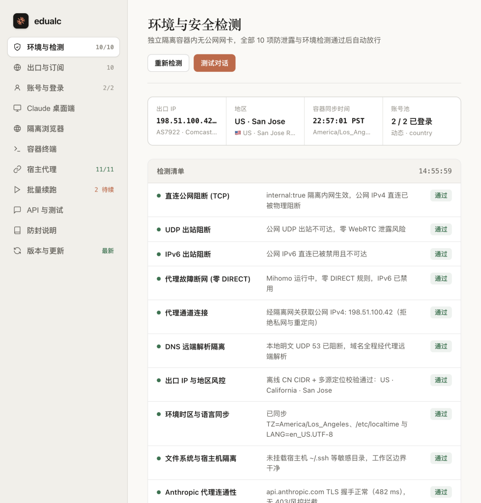
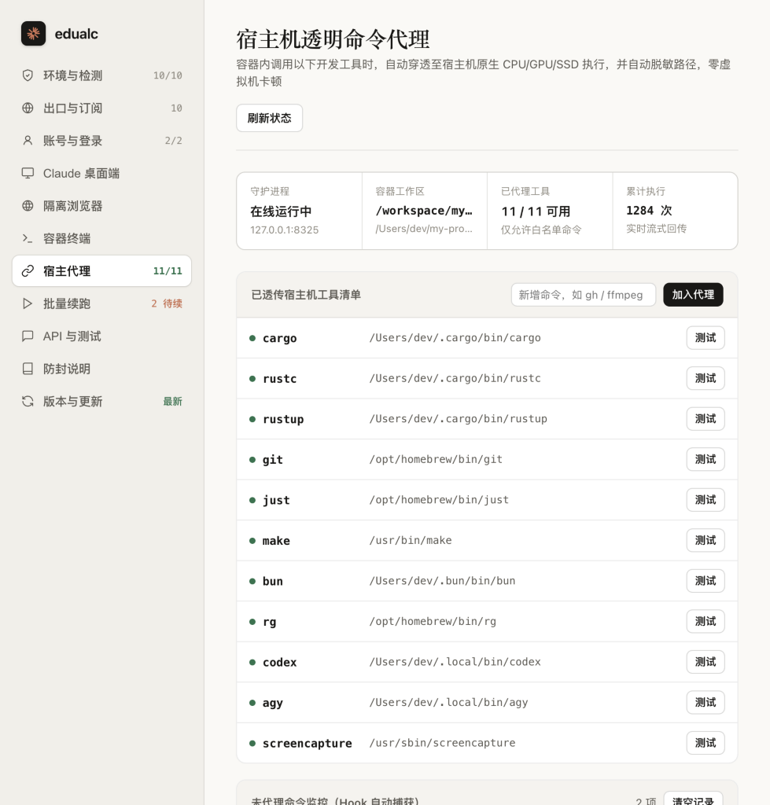
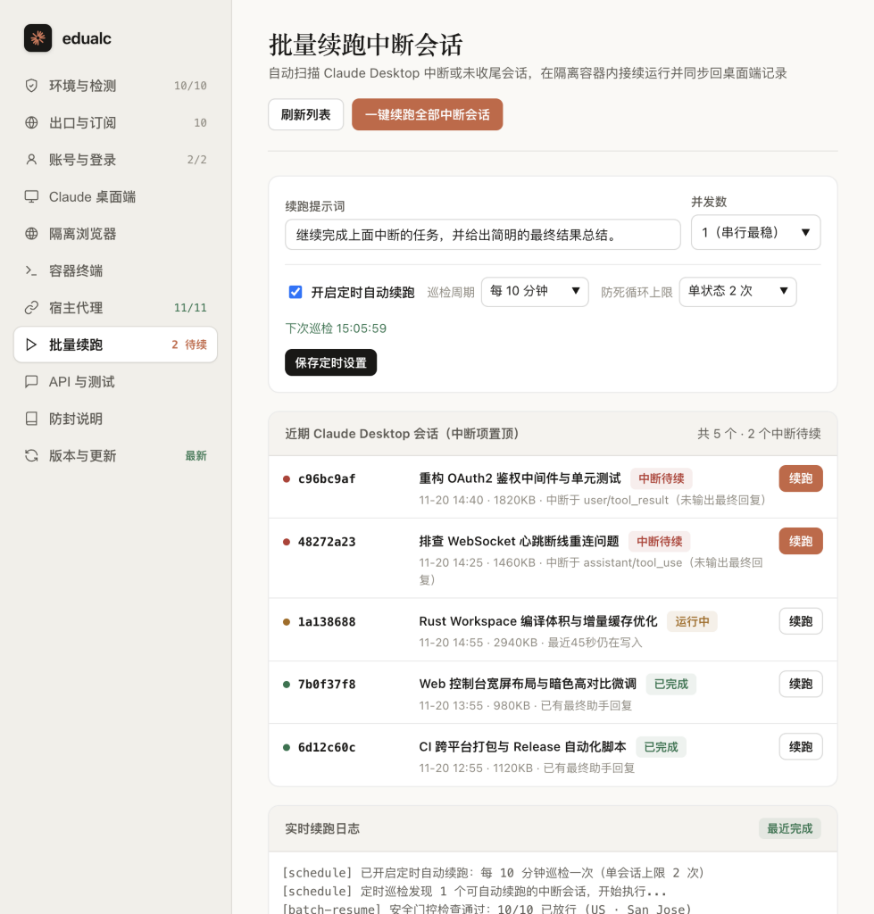
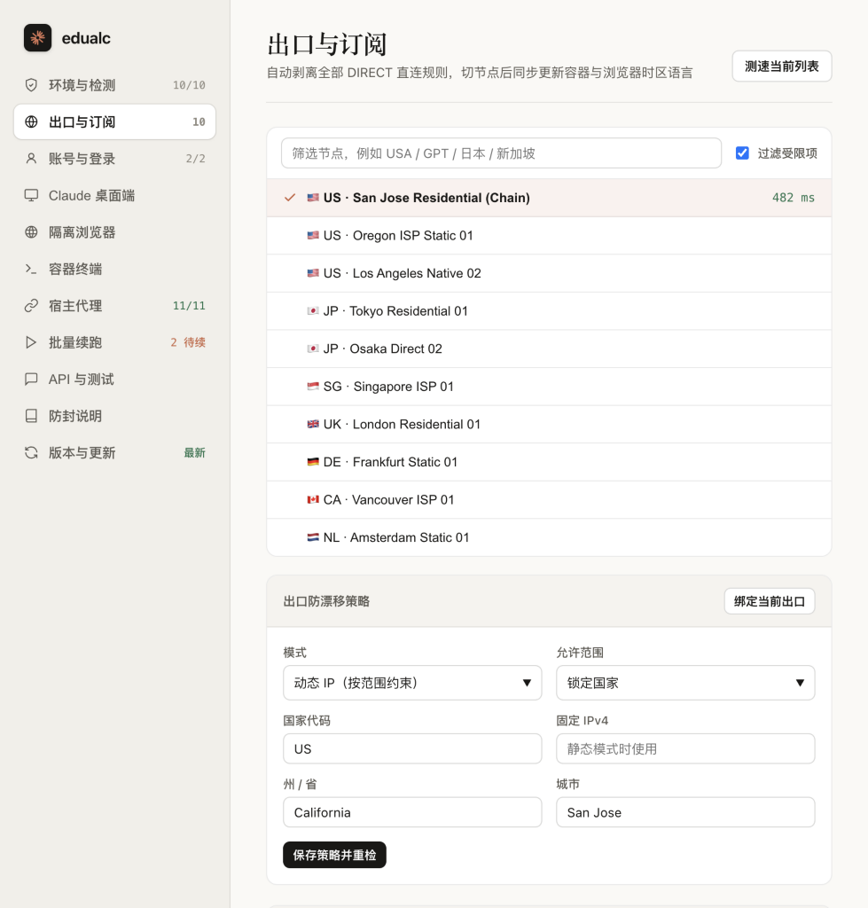
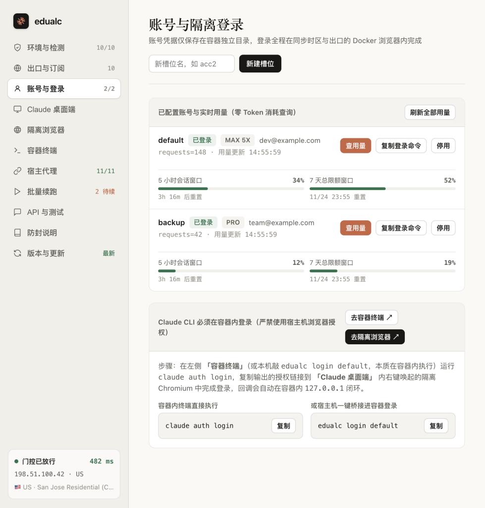
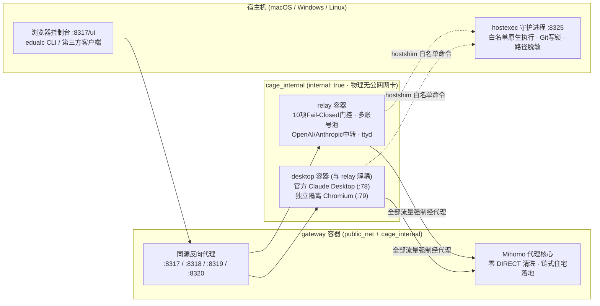

<div align="center">


# edualc

**把 Claude 全家桶关进「零泄露 Docker 隔离舱」，同时保留宿主机 100% 原生开发速度。**

<sub>`edualc` = `claude` 的镜像反转 · 官方 Claude Desktop + Claude Code CLI + 隔离 Chromium + 宿主机透明命令代理 + 中断会话定时续跑</sub>

<br />


[痛点与对比](#-为什么需要-edualc) · [实机界面](#-实机界面预览) · [核心架构](#-系统架构) · [3 分钟上手](#-3-分钟快速上手) · [CLI 速查](#-cli-与第三方客户端接入) · [防封指南](docs/ANTI_BAN_GUIDE.md)

<br />



</div>

---

## 💡 为什么需要 `edualc`？

深度用 Claude Desktop / Claude Code 写大项目时，几乎所有人都会踩这 4 个坑：

| 痛点场景 | 传统做法的尴尬 | `edualc` 的解法 |
| :--- | :--- | :--- |
| **怕环境串味触发风控** | 代理一闪断就回落直连、IPv6/UDP/WebRTC 泄露、系统还是 `Asia/Shanghai` + `zh-CN`、宿主机浏览器 Cookie 混用 | **物理无公网网卡 (`internal: true`) + 强制剥离全部 `DIRECT` + 10 项 Fail-Closed 熔断门控**，出口 IP 自动同步容器与浏览器时区/语言 |
| **塞进 Docker 后编译太慢** | 在虚拟机里跑 `cargo` / `bun` / `git` 慢如蜗牛，还得在容器内重装整套原生工具链 | **宿主机透明命令代理 (`hostexec` + `hostshim`)**：白名单工具自动穿透宿主机原生 CPU/GPU/SSD 执行，路径自动脱敏，Claude 零感知 |
| **长任务跑到一半断流卡死** | 睡前扔给 Claude Desktop 一堆任务，半夜网络抖动停在 `tool_result`，醒来白等一夜 | **外置批量续跑 & 定时自动续跑**：精准区分「中断」与「已完结」，定时巡检自动接续跑完并实时同步回 Desktop 界面 |
| **全家桶入口割裂、难管理** | 桌面端、CLI、防关联浏览器、多账号额度、节点测速、API 中转各自为战 | **单页同源 Web 控制台**：一站集成 Claude Desktop、隔离 Chromium、Web 终端、链式代理、零 Token 查额度与 OpenAI/Anthropic 本地转发 |

---

## 📸 实机界面预览

<table>
  <tr>
    <td width="50%" valign="top">
      <b>⚡ 宿主机透明命令代理（隔离不掉速）</b><br />
      <sub>容器内调用 <code>cargo / git / bun / just / rg</code> 等自动穿透宿主机原生执行；内置 <code>git</code> 写锁防索引冲突，Hook 自动捕获缺失命令一键热加。</sub>
      <br /><br />
      
    </td>
    <td width="50%" valign="top">
      <b>🔄 中断会话批量续跑 &amp; 定时自动续跑</b><br />
      <sub>精准识别 <code>STALLED / ACTIVE / DONE</code>，支持定时巡检、防死循环重试上限与门控等待，结果实时写回 Claude Desktop。</sub>
      <br /><br />
      
    </td>
  </tr>
  <tr>
    <td width="50%" valign="top">
      <b>🌐 出口订阅、链式住宅落地 &amp; 防漂移锁定</b><br />
      <sub>支持 Clash/Mihomo 订阅零 <code>DIRECT</code> 清洗、节点批量测速、机场前置 → 静态住宅 IP 链式落地，一键锁死国家/城市/IP。</sub>
      <br /><br />
      
    </td>
    <td width="50%" valign="top">
      <b>👤 多账号池 &amp; 零 Token 实时额度监控</b><br />
      <sub>每账号独立 <code>CLAUDE_CONFIG_DIR</code> 彻底隔离，429 自动冷却切号；零 Token 消耗实时查看 5 小时 / 7 天限额窗口。</sub>
      <br /><br />
      
    </td>
  </tr>
</table>

---

## ✨ 四大硬核能力

### 1. 🛡️ 10 项 Fail-Closed 安全门控（红灯即熔断，绝不裸奔）
- **物理断网隔离**：`relay` 与 `desktop` 位于 Docker `internal: true` 纯内网，无公网网卡、无直连路由；
- **零 `DIRECT` 清洗**：导入任何 Clash / Mihomo 订阅都会自动剥离 `DIRECT` 规则并关闭 IPv6，代理断线直接拒连；
- **10 项实时自检**：直连 TCP 阻断、UDP 阻断、IPv6 阻断、零 `DIRECT` 校验、代理通道连通、远端 DNS 隔离、离线中国大陆 CIDR + 多源地理风控、时区与 `LANG` 同步、宿主机目录边界检查、`api.anthropic.com` TLS 延迟检测（ms）；
- **自动自愈**：内置 3 次退避重试 + 每 20 秒后台巡检恢复绿灯。

### 2. ⚡ 宿主机全工具链代理 & 缺失命令自动安装（兼顾绝对隔离与满血性能）
- **全生态无感穿透**：容器内执行 `cargo`、`rustc`、`rustup`、`git`、`just`、`make`、`bun`、`rg`、`python3`、`pip`、`node`、`npm`、`npx`、`brew`、`codex`、`agy` 等工具时，自动转发至宿主机原生 CPU/GPU/SSD 运行，输出中的宿主机路径自动脱敏为 `/workspace/...`；
- **专属宿主 Python 环境**：自动初始化独立 `data/host-venv`（优先选用预编译轮子最全的 Python 3.12），彻底告别 Homebrew PEP 668 报错与系统环境污染，装一次所有会话永久复用；
- **缺啥自动接管 / 自动安装**：`PreToolUse` Hook 在 Bash 执行前自动探测缺失命令——宿主机已有则**瞬间热接管代理**，宿主机也没有则自动走 `brew / pip / npm / winget` **自动装到宿主机并挂接代理**（Web 控制台可随时一键开关与审计）；
- **安全与并发护栏**：`git` 写操作串行互斥锁（消灭 `.git/index.lock` 冲突）、进程组 PGID 级联清理、强制拦截 `sudo`/`rm`/`curl`/`ssh` 等高危或旁路网络命令，严守防封红线。

### 3. 🔄 智能中断判定 & 定时自动续跑
直接解析 Claude Desktop 会话 `.jsonl` 转录记录，精准分类绝不乱续跑：
- **`ACTIVE`（运行中）**：45 秒内仍有写入 → **绝不打扰**；
- **`STALLED`（中断待续）**：停在 `tool_use` / `tool_result` / `thinking` / 未回复的 `user` 消息或 `[Tool call interrupted` → **自动续跑**；
- **`DONE`（已完成）**：已有正常助手纯文本回复（含正常收尾或停下来问你做决策）→ **绝不误续跑**；
- 支持 **每 5 ~ 60 分钟定时巡检**、按 `<会话ID>:<文件KB>` 指纹计数的 **防死循环上限（1~3 次）**，以及续跑前自动等待 `10/10` 绿灯。

### 4. 🖥️ 全家桶同源体验（Desktop 不掉线）
- **官方 Claude Desktop**：独立容器网络与 `relay` 解耦，升级或重启中转服务时 **Desktop 会话零中断**；支持双向 UTF-8 剪贴板、Mac/Win 快捷键、宿主机原生中文输入条（`Option/Alt + Space`），点击外部链接自动跳到隔离 Chromium；
- **独立隔离 Chromium**：同出口 IP、同步时区与 `Accept-Language`、禁用非代理 WebRTC UDP，OAuth 登录回调容器内闭环；
- **内置 Web 终端 + 本地兼容 API**：内置 `ttyd` 终端与原生协议 OpenAI (`/v1`) / Anthropic 本地转发。

---

## 🏗️ 系统架构



---

## 🚀 3 分钟快速上手

### 环境要求
- **macOS**：Docker 运行时（推荐 [Colima](https://github.com/abiosoft/colima) / OrbStack / Docker Desktop）+ Go 1.22+ + Python 3
- **Windows**：Docker Desktop（WSL2 后端）+ Go 1.22+ + Python 3
- **Linux**：Docker Engine + Docker Compose v2 + Go 1.22+ + Python 3

### Step 1：克隆并配置工作区
```bash
git clone https://github.com/droog126/edualc.git
cd edualc
cp .env.example .env
```
按需编辑 `.env` 中的 `WORKSPACE_DIR`（挂载单个需要开发的项目目录，**切勿挂载整个家目录或 `~/.ssh`**）与 `WORKSPACE_NAME`。

### Step 2：一键启动全栈服务
- **macOS / Linux**：
  ```bash
  ./scripts/start.sh
  ```
- **Windows (PowerShell)**：
  ```powershell
  .\scripts\start.ps1
  ```

### Step 3：配置出口并完成隔离登录
1. 浏览器打开 **http://127.0.0.1:8317/ui** → **「出口与订阅」**，导入 Clash / Mihomo 订阅（强烈推荐叠加 **「链式落地静态住宅 IP」**）或单个静态代理，选定海外节点；
2. 看到状态变为 **`10/10` 绿灯放行** 后，点击 **「绑定当前出口」** 锁死地区防止地理瞬移；
3. **全程在隔离环境内登录**（严禁使用宿主机日常浏览器授权）：
   - **Claude Desktop**：在左侧 **「Claude 桌面端」** 直接登录，授权页会自动在隔离 Chromium 内打开；
   - **Claude CLI**：在 **「容器终端」** 运行 `claude auth login`，或本机运行 `./scripts/login.sh default`（Windows：`.\scripts\login.ps1 -Account default`）。

---

## ⌨️ CLI 与第三方客户端接入

推荐将 `scripts/edualc` 软链到 `~/.local/bin/edualc`（Windows 将 `scripts/` 加入 `PATH`）：

```bash
edualc status               # 查看 10 项安全门控、出口 IP、延迟与账号池
edualc                      # 直连进入容器 /workspace 交互终端
edualc claude               # 在隔离容器内启动官方 claude CLI（红灯自动拦截）
edualc browser [URL]        # 在隔离 Chromium 中打开任意网页
edualc resume --list        # 扫描近期 Claude Desktop 中断会话
edualc resume --all         # 一键批量续跑全部中断会话
```

**接入 Cherry Studio / OpenAI SDK / Anthropic SDK：**

| 接口类型 | Base URL | API Key | 可用模型 |
| :--- | :--- | :--- | :--- |
| **OpenAI 兼容** | `http://127.0.0.1:8317/v1` | 本机免密填任意占位符（如 `sk-local`） | `sonnet` / `opus` / `haiku` |
| **Anthropic 原生** | `http://127.0.0.1:8317` | 同上（或 `.env` 中 `RELAY_API_KEY`） | 同上 |

---

## 📚 延伸阅读 & 致谢

- 📖 [Claude 账号防封与环境隔离实操指南（IP · 付款 · 浏览器指纹）](docs/ANTI_BAN_GUIDE.md)
- 📄 本项目以 [MIT License](LICENSE) 开源，仅限个人合法合规自用与学习研究；离线中国大陆 IPv4 网段表参考自 MIT 许可的开源社区数据。

<div align="center">
  <br />
  <sub>如果 <b>edualc</b> 帮你稳住了账号、解放了开发效率，欢迎点个 ⭐ <b>Star</b> 支持一下！</sub>
</div>
